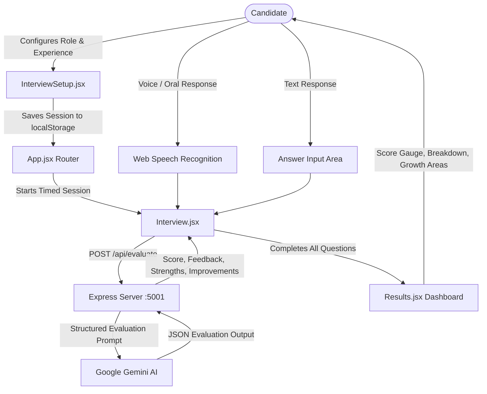

# 🎯 InterviewAce AI – Intelligent Mock Interview & Evaluation Platform

[](https://react.dev/)
[](https://vitejs.dev/)
[](https://nodejs.org/)
[](https://expressjs.com/)
[](https://ai.google.dev/)
[](LICENSE)

An intelligent, full-stack technical interview preparation platform designed to help software engineering candidates practice technical interviews, speak or type their answers in real-time, and receive objective evaluation and actionable feedback powered by **Google Gemini AI**.

---

## 🌟 Key Features

- 🤖 **Automated AI Answer Evaluation**: Real-time evaluation of answers using Google Gemini AI (`gemini-3.5-flash-lite`).
- 🎙️ **Speech-to-Text Voice Input**: Integrated Web Speech API for realistic mock interview practice through oral answering.
- 📊 **Objective Scoring & Rubrics**: 0-10 numerical scoring based on technical correctness, clarity, depth, and relevance.
- 💡 **Actionable Feedback**: Pinpointed strengths and up to 3 targeted improvement recommendations per answer.
- ⚙️ **Configurable Interview Sessions**: Select target job roles (*Frontend Developer*, *Backend Developer*, *Full Stack Developer*, *Java Developer*, *Python Developer*), experience level, and question count.
- ⏱️ **Real-Time Pacing Timer**: Live per-question timer with automatic submission on expiration to simulate actual interview pressure.
- 📈 **Comprehensive Results Dashboard**: Overall performance score, percentage metrics, answer review drawer, and instant session restart.

---

## 👥 Contributors & Team Division

| Contributor | GitHub Profile | Primary Contributions & Focus |
|---|---|---|
| **Suyog Shelke** | [@suyogshelke](https://github.com/suyogshelke) | **Backend Architecture & AI Core**: Express server, Google Gemini integration (`@google/genai`), prompt engineering, evaluation endpoints, request timeouts, and error handling. |
| **Aditya Aman** | [@aditya12aman13](https://github.com/aditya12aman13) | **Frontend Architecture & UI/UX**: Vite + React scaffolding, design tokens & styling (`App.css`), `InterviewSetup.jsx`, responsive layout, landing page, and navigation. |
| **Rishav Kumar** | [@rishavkr2002](https://github.com/rishavkr2002) | **Interactive Flow & Analytics**: `Interview.jsx` voice input & speech synthesis, timer engine, question datasets, `Results.jsx` performance metrics, and question review. |

---

## 🏗️ Architecture & Data Flow



---

## 💻 Tech Stack

### Frontend
- **Framework**: React 19 + Vite
- **Styling**: Tailwind CSS + Custom CSS Variables & Animations (`App.css`, `index.css`)
- **Routing**: React Router DOM v7
- **APIs**: Web Speech Recognition API & Web SpeechSynthesis

### Backend
- **Runtime**: Node.js
- **Server**: Express 5
- **AI Integration**: `@google/genai` (Google Gemini GenAI SDK)
- **Utilities**: `dotenv`, `cors`, `nodemon`

---

## 🚀 Getting Started

### Prerequisites
- [Node.js](https://nodejs.org/) (v18 or higher recommended)
- [Git](https://git-scm.com/)
- [Google Gemini API Key](https://aistudio.google.com/)

### 1. Clone the Repository
```bash
git clone https://github.com/suyogshelke/InterviewAceAi.git
cd InterviewAceAi
```

### 2. Backend Setup
```bash
cd server
npm install
```

Create a `.env` file in the `server` directory:
```env
PORT=5001
GEMINI_API_KEY=your_gemini_api_key_here
```

Start the backend server:
```bash
npm run dev
# Server runs on http://localhost:5001
```

### 3. Frontend Setup
In a new terminal window:
```bash
cd client
npm install
npm run dev
# Frontend runs on http://localhost:5173
```

---

## 📡 API Endpoints

### `GET /`
- **Description**: Health check endpoint.
- **Response**:
```json
{
  "success": true,
  "message": "Interview Ace AI API is running",
  "aiProvider": "Google Gemini",
  "model": "gemini-3.5-flash-lite",
  "timeout": 90000,
  "port": 5001
}
```

### `POST /api/evaluate`
- **Description**: Evaluates candidate interview response using Gemini AI.
- **Request Body**:
```json
{
  "question": "What is the difference between props and state in React?",
  "answer": "Props are read-only inputs passed from a parent component, while state is managed internally by the component and can change over time."
}
```
- **Response Body**:
```json
{
  "success": true,
  "score": 9,
  "feedback": "Clear, accurate, and concise distinction between props and state in React.",
  "strengths": [
    "Correctly identified props as read-only and passed from parent.",
    "Accurately stated that state is component-internal and mutable."
  ],
  "improvements": [
    "Could mention that changes to state trigger a re-render of the component."
  ]
}
```

---

## 📜 License
This project is open source and available under the [MIT License](LICENSE).
