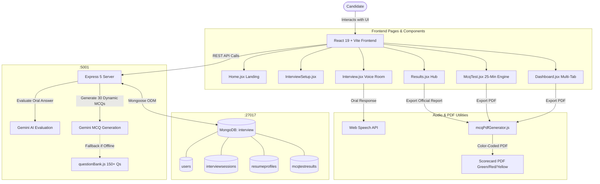

# 🎯 InterviewAce AI – Intelligent Mock Interview & Evaluation Platform

[](https://react.dev/)
[](https://vitejs.dev/)
[](https://nodejs.org/)
[](https://expressjs.com/)
[](https://www.mongodb.com/)
[](https://ai.google.dev/)
[](https://tailwindcss.com/)
[](https://github.com/parallax/jsPDF)
[](LICENSE)

An intelligent, full-stack technical interview preparation platform designed to help software engineering candidates practice realistic verbal interviews, take time-bound 30-question technical MCQ assessments, scan resumes for ATS readiness, and receive objective evaluation and actionable feedback powered by **Google Gemini AI** with permanent **MongoDB** persistence.

---

## 🌟 Key Features

### 🎙️ Verbal AI Mock Interviews
- **Real-Time Gemini AI Evaluation**: Answers evaluated in real time using Google Gemini (`gemini-3.5-flash-lite`).
- **Speech-to-Text & Oral Input**: Native Web Speech Recognition API enables spoken responses with a live microphone visualizer.
- **Objective Rubric Scoring (0–10)**: Strict assessment across technical correctness, clarity, depth, and relevance.
- **Actionable Growth Roadmap**: Pinpointed strengths and up to 3 prioritized improvement recommendations per answer.
- **Pacing Engine**: Live countdown timer with automated submission when time expires.

### 🧠 25-Minute Mock MCQ Test (30 Questions)
- **Dynamic AI Question Generation**: On-the-fly generation of 30 technical multiple-choice questions tailored to the candidate's exact role and seniority via `POST /api/generate-questions`.
- **Offline Curated Question Bank**: Built-in 150+ question fallback bank covering Full Stack, Frontend, Backend, Python, and Java.
- **Time-Bound 25-Minute Assessment**: Live countdown timer with color states (Green $\rightarrow$ Yellow warning $\rightarrow$ Red pulsing) and auto-submission on expiration.
- **Interactive Question Palette**: Direct navigation across questions 1–30, with real-time answered, unattempted, and flagged badges.

### 📄 Color-Coded Performance Reports (PDF)
- **Official Downloadable PDF Scorecards**: Generates branded reports via `jspdf` and `jspdf-autotable`.
- **Strict Color-Coded Answer Audit**:
  - 🟩 **Right Questions Answered**: Displayed in **GREEN** (`[220, 252, 231]` bg / `[22, 101, 52]` text with `✓ Right Answer` badge).
  - 🟥 **Wrong Questions**: Displayed in **RED** (`[254, 226, 226]` bg / `[185, 28, 28]` text with `✕ Wrong Answer` badge).
  - 🟨 **Not Attempted Questions**: Displayed in **YELLOW** (`[254, 243, 199]` bg / `[180, 83, 9]` text with `⚠ Not Attempted` badge).
- Available across the **Results Section**, **Post-Test Screen**, **Dashboard History**, and **Inspection Modal**.

### 📊 Candidate Analytics Dashboard (`/dashboard`)
- **Executive Overview**: High-level KPI cards, Radar breakdown, competency distribution, and preparation goal readiness.
- **Interview History Archive**: Searchable and filterable record of past verbal interviews with modal deep-dives and PDF downloads.
- **MCQ Test History**: Complete log of 30-MCQ test attempts, percentage scores, topic breakdowns, and color-coded question reviews.
- **Resume & ATS Scanner**: Upload and parse candidate resumes, extract tech stacks, generate an ATS Match Score (0–100%), and trigger role-tailored custom interviews.
- **Profile Management**: Maintain target roles, years of experience, bio, target companies, and portfolio links.

### 💾 Robust MongoDB Database Persistence
- Connected to MongoDB (`mongodb://localhost:27017/interview`) with automated sample data seeding on startup.
- Four distinct Mongoose models: `User`, `InterviewSession`, `ResumeProfile`, and `McqTestResult`.

---

## 👥 Contributors & Team Division

| Contributor | GitHub Profile | Primary Contributions & Focus |
|---|---|---|
| **Suyog Shelke** | [@suyogshelke](https://github.com/suyogshelke) | **Backend Architecture, Database & AI Core**:<br>• Node.js & Express 5 REST server architecture<br>• Local MongoDB integration (`mongodb://localhost:27017/interview`) & Mongoose schemas (`User`, `InterviewSession`, `ResumeProfile`, `McqTestResult`)<br>• Google Gemini AI SDK integration (`@google/genai`) for answer evaluation and 30-MCQ dynamic test generation (`POST /api/generate-questions`)<br>• Official Color-Coded PDF Generator (`mcqPdfGenerator.js`) supporting Green (Right), Red (Wrong), and Yellow (Not Attempted) color standards<br>• Database seeding, error handling, CORS, and request timeout resilience. |
| **Aditya Aman** | [@aditya12aman13](https://github.com/aditya12aman13) | **Frontend Architecture & Design System**:<br>• Vite + React 19 architecture, Tailwind CSS design tokens, and glassmorphic UI system<br>• Candidate Dashboard (`Dashboard.jsx`) with multi-tab layout (`OverviewTab`, `HistoryTab`, `McqTab`, `ResumeTab`, `ProfileTab`)<br>• Modal dialogs: `InterviewDetailModal`, `McqDetailModal`, `ProfileEditModal`<br>• Interactive Radar Chart (`RadarChart.jsx`), Score Gauges, and KPI Stat Cards (`StatCard.jsx`)<br>• Responsive navigation, custom layout headers, and footers. |
| **Rishav Kumar** | [@rishavkr2002](https://github.com/rishavkr2002) | **Interactive Flow, MCQ Engine & Analytics**:<br>• Voice interview engine (`Interview.jsx`) with Web Speech API integration & live microphone visualization<br>• 25-minute countdown timer engine with auto-submission trigger on expiration<br>• 30-MCQ interactive testing canvas (`McqTest.jsx`) with question palette navigation, flag toggling, and review state<br>• Results hub (`Results.jsx`) with dual-mode view switcher (Verbal Interview vs. Mock MCQ Test)<br>• Custom React hooks: `useMcqTest`, `useInterviewHistory`, `useResumeParser`, `useProfile`, and `useAuth`. |

---

## 🏗️ Architecture & Data Flow



---

## 💻 Tech Stack

### Frontend
- **Framework**: React 19 + Vite
- **Styling**: Tailwind CSS + Custom Dark Theme & Glassmorphism (`index.css`)
- **Routing**: React Router DOM v7
- **PDF Generation**: `jspdf` & `jspdf-autotable`
- **Speech APIs**: Web Speech Recognition API & Web SpeechSynthesis
- **Charts & Gauges**: Canvas / SVG Radar & Circular Meter Visualizations

### Backend
- **Runtime**: Node.js (v18+)
- **Server Framework**: Express 5
- **Database**: MongoDB (Local `mongodb://localhost:27017/interview` or MongoDB Atlas)
- **Object Data Modeling**: Mongoose 8
- **AI Integration**: `@google/genai` (Google Gemini SDK — `gemini-3.5-flash-lite`)
- **Utilities**: `dotenv`, `cors`, `nodemon`

---

## 🚀 Getting Started

### Prerequisites
- [Node.js](https://nodejs.org/) (v18 or higher recommended)
- [MongoDB](https://www.mongodb.com/try/download/community) installed and running locally on port `27017` (or a MongoDB Atlas connection URI)
- [Git](https://git-scm.com/)
- [Google Gemini API Key](https://aistudio.google.com/)

---

### 1. Clone the Repository
```bash
git clone https://github.com/suyogshelke/InterviewAceAi.git
cd InterviewAceAi
```

---

### 2. Backend Configuration & Setup
```bash
cd server
npm install
```

Create a `.env` file in the `server` directory:
```env
PORT=5001
MONGODB_URI=mongodb://localhost:27017/interview
GEMINI_API_KEY=your_gemini_api_key_here
```

Start the backend server:
```bash
npm run dev
# Server will connect to MongoDB and start on http://localhost:5001
```

> **Note**: On the first start, the server automatically connects to MongoDB and seeds initial profile, interview sessions, and MCQ test data for demonstration.

---

### 3. Frontend Setup
In a separate terminal:
```bash
cd client
npm install
npm run dev
# Frontend development server runs on http://localhost:5173 (or http://localhost:5174)
```

Open your browser and navigate to `http://localhost:5173`.

---

## 📡 API Endpoints Reference

### 1. System Health
#### `GET /`
- **Description**: Health check and runtime configuration.
- **Response**:
```json
{
  "success": true,
  "message": "Interview Ace AI API is running",
  "aiProvider": "Google Gemini",
  "model": "gemini-3.5-flash-lite",
  "database": "MongoDB Connected (mongodb://localhost:27017/interview)",
  "timeout": 90000,
  "port": 5001
}
```

---

### 2. AI Verbal Evaluation
#### `POST /api/evaluate`
- **Description**: Evaluates a candidate's verbal interview response using Gemini AI.
- **Request Body**:
```json
{
  "question": "What is the difference between props and state in React?",
  "answer": "Props are read-only inputs passed from a parent component, while state is managed internally by the component and can change over time."
}
```
- **Response Body**:
```json
{
  "success": true,
  "score": 9,
  "feedback": "Clear, accurate, and concise distinction between props and state in React.",
  "strengths": [
    "Correctly identified props as read-only and passed from parent.",
    "Accurately stated that state is component-internal and mutable."
  ],
  "improvements": [
    "Could mention that changes to state trigger a re-render of the component."
  ]
}
```

---

### 3. Dynamic 30-MCQ Question Generation
#### `POST /api/generate-questions`
- **Description**: Dynamically generates 30 multiple-choice technical questions with Gemini AI tailored to the role and seniority level.
- **Request Body**:
```json
{
  "role": "Full Stack Developer",
  "experience": "Fresher",
  "count": 30
}
```
- **Response Body**:
```json
{
  "success": true,
  "role": "Full Stack Developer",
  "experience": "Fresher",
  "count": 30,
  "source": "gemini-ai",
  "questions": [
    {
      "id": 1,
      "question": "Which HTTP method is idempotent according to REST standards?",
      "options": ["POST", "GET", "PATCH", "CONNECT"],
      "correctOption": 1,
      "explanation": "GET requests are idempotent because making multiple identical requests has the same effect as a single request.",
      "topic": "Web Protocols & REST"
    }
  ]
}
```

---

### 4. Mock MCQ Test Persistence
#### `GET /api/mcq-tests?email=candidate@gmail.com`
- **Description**: Retrieves all saved 30-MCQ test records for a user from MongoDB.

#### `GET /api/mcq-tests/:id`
- **Description**: Retrieves a single 30-MCQ test record with full questions, options, candidate selections, and AI explanations.

#### `POST /api/mcq-tests`
- **Description**: Evaluates, grades, and permanently stores a completed 30-question MCQ test in MongoDB.

---

### 5. Candidate Profile & Interview History
#### `GET /api/user/profile?email=candidate@gmail.com`
- **Description**: Fetches user profile, skills, preparation goals, and target companies from MongoDB.

#### `PUT /api/user/profile`
- **Description**: Updates profile details in MongoDB.

#### `GET /api/interviews?email=candidate@gmail.com`
- **Description**: Fetches past verbal mock interview sessions.

#### `POST /api/interviews`
- **Description**: Saves a newly completed verbal interview session with scores, feedback, and radar breakdowns.

---

### 6. Resume & ATS Analysis
#### `GET /api/resume?email=candidate@gmail.com`
- **Description**: Retrieves current ATS resume profile.

#### `POST /api/resume/scan`
- **Description**: Uploads and scans resume text, calculating ATS match score, recognized skills, and role fit.

---

## 🎨 Color-Coding Specifications for MCQ Reports

When reviewing MCQ tests in the UI or exporting to PDF:

| Status | Color | RGB Background | RGB Text | Visual Badge |
|---|---|---|---|---|
| **Right Answer** | **Green** | `[220, 252, 231]` | `[22, 101, 52]` | `✓ Right Answer` |
| **Wrong Answer** | **Red** | `[254, 226, 226]` | `[185, 28, 28]` | `✕ Wrong Answer` |
| **Not Attempted** | **Yellow / Amber** | `[254, 243, 199]` | `[180, 83, 9]` | `⚠ Not Attempted` |

---

## 📜 License
This project is open source and available under the [MIT License](LICENSE).
